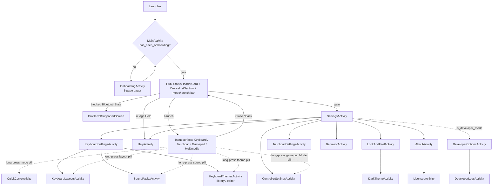
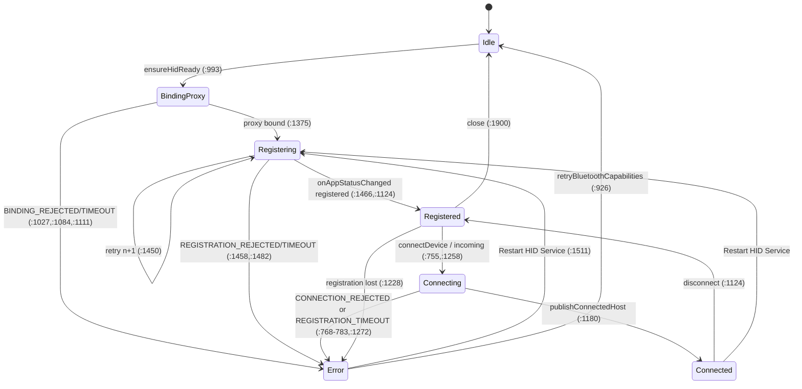
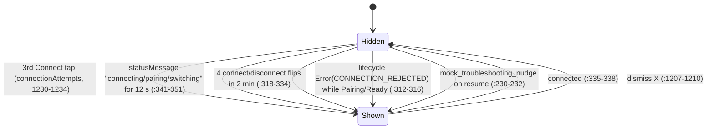
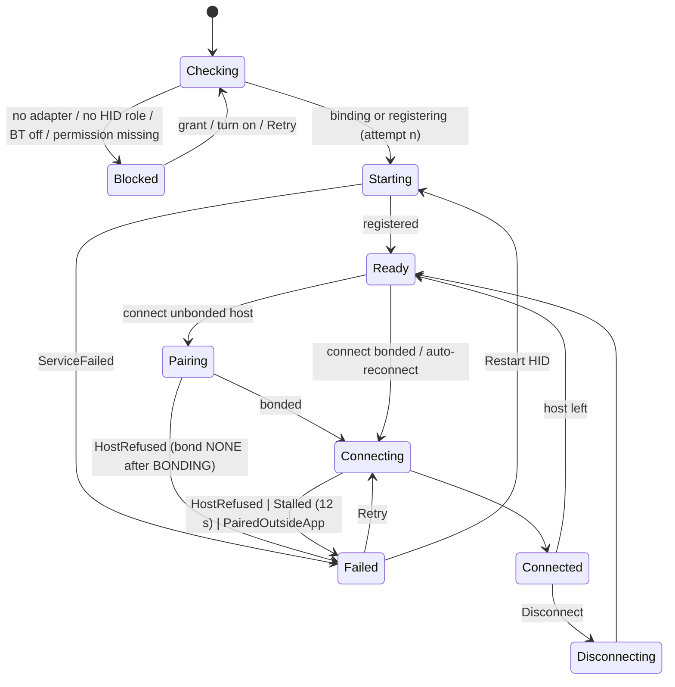

# Bluke UX flow audit: surfaces, state machines, cuts

Source: worktree `~/.t3/worktrees/Bluke/t3-3cfd70f1-2acbc8e7503662b3` at `ef897d8`. All paths below are relative to `app/src/main/java/dev/arnv/bluke/` unless they start with `app/` or `tools/`. Line numbers are from that commit.

---

## 0. Top findings in one screen

1. **18 Activities for ~45 settings.** Five of them hold four controls or fewer (`DarkThemeActivity` 4, `ControllerSettingsActivity` 1 row → 3-way dialog, `TouchpadSettingsActivity` 3, `QuickCycleActivity` 4 checkboxes, `BehaviorActivity` 6 switches). `QuickCycleActivity` is reachable *only* by long-pressing a toolbar pill inside an input surface; Settings never links to it.
2. **Connection state is an implicit machine encoded in English strings.** `DeviceRow.kt:157-169`, `HomeUiPolicy.kt:27-36`, `HomeScreen.kt:341-351` and `DeviceListSection.kt:50,68` decide "working / error / attempt in progress / show active row" by `statusMessage.contains("Connecting" | "Pairing with" | "rejected" | "Disconnected" | device name …)`. Two explicit machines (`BluetoothState`, `HidLifecycleState`) plus five loose flows (`connectedDevice`, `connectionTargetAddress`, `hasPendingConnection`, `isScanning`, `statusMessage`) feed every status indicator, and four surfaces compute "connected" from two different sources.
3. **A whole explicit machine is dead.** `requiresGamepadDescriptorRestart` returns `false` unconditionally (`bluetooth/GamepadDescriptor.kt:142-145`), so `switchGamepadDescriptor`, `GamepadModeSwitchState.REGISTERING/RECONNECTING`, `gamepadModeSwitchError`, and the busy/error dialogs in `ui/GamepadView.kt:424-464` can never run. Copy about "after updating to the shared controller descriptor, forget both devices" survives in three places.
4. **Settings live far from what they affect, and the same concept is split.** Touchpad pointer/scroll speed exist only on the touchpad toolbar; scroll direction/momentum exist only in Settings. "Volume buttons control host volume — only while Multimedia is open" lives in Behavior. Key sound on/off lives in Look & Feel, sound packs in Keyboard, mute on the keyboard toolbar. Haptics is four prefs (`haptics_enabled` keyboard-only, `touchpad_vibration_enabled` touchpad+multimedia, `gamepad_vibration_enabled`), and the global "Haptics & Vibration" switch doesn't affect three of four surfaces.
5. **Dead or contradictory setting combos.** Palette style offers 9 choices, 7 render identically (`ui/theme/Theme.kt:103-110`), and all 9 are dead when Dynamic colors is on (still shown). High-contrast is dead in light mode (still shown). Sound packs can be cycled while muted. Permission-denied leaves Launch enabled with no grant CTA. An input surface stays open after Bluetooth turns off.
6. **Unpersisted surface state.** Touchpad button mode and numpad overlay (`ui/TouchpadView.kt:82-83`) and gamepad console layout (`ui/GamepadView.kt:153`) reset every time the surface is re-entered.
7. **Dead first-run code.** `HelpActivity`'s `first_run` countdown path is never triggered (no caller sets the extra); `has_seen_help` is written, never read; a generic "Updated to vX" dialog fires on every version bump; onboarding forces a 5 s countdown; two Rickroll easter eggs (one on the home title, toasting on each tap).

**Target IA (detail in §6):** one `MainActivity` with a hub whose connection card is driven by one `ConnectionUi` sealed type and whose four mode tiles launch in one tap; each input surface gets a "tune" bottom sheet holding that surface's settings; one `SettingsActivity` with collapsible sections replaces Look & Feel, Dark theme, Keyboard, Touchpad, Controller, Behavior and Quick cycle; Keyboard themes (editor), Sound packs (import), Help, About+Licenses and Developer stay full screens. 18 Activities → 8; common tasks drop to 1-2 taps.

---

## 1. Surface inventory

### 1.1 Navigation map today



All Activities are declared in `app/src/main/AndroidManifest.xml:35-60`; none are exported except `MainActivity`, so no external deep links exist. The only "deep links" are the five in-app long-press `startActivity` calls.

### 1.2 Activities

| Screen | How you reach it | Controls | Prefs written (`app_prefs` unless noted) | Depends on / notes |
|---|---|---|---|---|
| `MainActivity` (`MainActivity.kt`) | Launcher | none of its own; hosts `HomeScreen` | none (migrations `migrateSoundPreferences`, `migrateKeyboardCustomizationPreferences` at :47-48) | Redirects to onboarding if `!has_seen_onboarding` (:49-53). Requests BT+location permissions on **every** `onCreate` (:86-100). Holds first frame until `serviceState != InitializingCapabilities` (:61-81). Routes hardware volume keys to Multimedia (`RemoteVolumeKeyHost`, :160-188). Starts/stops `BluetoothSessionService`. |
| `OnboardingActivity` | First launch only | Pager (swipe disabled) with clickable dots (:195-206); button "Let's Start" / "Grant Permissions"/"Continue" / "Let's go (5s)" (:210-242); "Open Settings" on denial (:405) | on finish: `has_seen_onboarding`, `has_seen_help`, `last_run_version_code`, `hid_descriptor_revision` (:69-74) | Dots let you skip the permission page. Page 3 countdown 5 s (:150-159). |
| `SettingsActivity` | Hub gear | 6 rows (+ Developer options when `is_developer_mode`) in 3 groups | none | Group "Controls & connection" contains one row, "Behavior" (:112-124). Re-reads dev mode on resume. |
| `LookAndFeelActivity` | Settings › Look & Feel | Accent pager (only if `!dynamic_color` or SDK<31, :94-188), Dynamic colors switch, Palette style (dialog of 9), Dark theme row → `DarkThemeActivity`, Haptics & Vibration switch, Enable sounds switch | `accent_color_index`, `dynamic_color`, `palette_style`, `haptics_enabled`, `key_sound_enabled` + `sound_toggle` (:286-289) | `sound_toggle` is legacy; only `sound/SoundPreferences.kt` migration reads it, once. Palette style shown even when dynamic color makes it dead. |
| `DarkThemeActivity` | Look & Feel › Dark theme | 3 radios System/Off/On; High contrast switch | `theme_mode` (0/1/2), `high_contrast_mode` | High contrast shown in "Off" (light) where it does nothing (`ui/theme/Theme.kt:122,131-133`). |
| `KeyboardSettingsActivity` | Settings › Keyboard | Key touch area slider (0-10); Typing layout (dialog, 6); Modifier keys (dialog PC/Mac); Caps Lock (dialog host/local); rows → Layouts, Themes, Key sound packs | `key_sensitivity`, `keyboard_character_layout`, `keyboard_modifier_style`, `lock_sync_mode` | "Caps Lock" governs all three lock LEDs. Modifier style also changes the touchpad's modifier rail. |
| `KeyboardLayoutsActivity` | Keyboard › Layouts; long-press layout pill | 7 geometry rows (tap = select + add to cycle); per-row "Include in toolbar cycle" checkbox | `keyboard_geometry`, `cycle_keyboard_geometries` | **Opening the screen can rewrite your layout** (`LaunchedEffect` :68-72 when stored layout isn't in cycle). |
| `KeyboardThemesActivity` | Keyboard › Themes; long-press theme pill | Library: "Create from <selected>", custom + built-in theme cards (tap select, cycle checkbox, ⋮ Copy/Edit/Delete); Editor (same Activity, `editingTheme != null`): name, preview geometry chips, edit target chips (Alpha/Mod/Accent/Key/Plate/Case), colour pickers, text size, metallic, Reset key, Cancel/Save | `keyboard_theme_id`, `cycle_keyboard_themes`, custom themes JSON (`data/KeyboardThemeRepository.kt`) | Two pages in one Activity via a nullable var + `BackHandler` (:130). |
| `SoundPacksActivity` | Keyboard › Key sound packs; long-press sound pill | 10 built-in + imported rows (tap select, cycle checkbox, delete for imports); FAB "Import pack" (SAF zip); delete confirm dialog; snackbar | `selected_builtin_key_sound`, `custom_sound_pack_id`, `cycle_key_sounds`, `sound_cycle_schema` | No "Off" choice; mute is elsewhere. |
| `TouchpadSettingsActivity` | Settings › Touchpad | Invert scroll switch; Momentum switch; Glide distance slider (only if momentum, :102-119); hint "Scroll speed is the arrows button on the touchpad's toolbar" | `touchpad_invert_scroll`, `touchpad_scroll_momentum`, `touchpad_scroll_glide` | Pointer/scroll speed not here. |
| `ControllerSettingsActivity` | Settings › Controller; long-press gamepad Mode pill | 1 row → 3-choice dialog (Native/Android/Web) | `gamepad_dpad_output_mode` | Dialog copy carries obsolete descriptor-migration text (:84). Same choice is one tap on the gamepad toolbar. |
| `BehaviorActivity` | Settings › Behavior | 6 switches: Reconnect on launch, Hide unnamed devices, Hide unlikely hosts, Show MAC addresses, Keep audio on this phone, Volume buttons control host volume | `auto_connect`, `hide_unknown`, `hide_unsupported`, `show_mac`, `disconnect_audio_profiles`, `media_hardware_volume_remote` | Row is titled "Behavior", top bar "Controls & connection" (:42), group "Behaviour" (:54). |
| `QuickCycleActivity` | **Only** long-press on the mode pill in any input surface (`ui/HomeScreen.kt:745-747`, `ui/TouchpadView.kt:193-195`, `ui/GamepadView.kt:608-610`, `ui/MediaPresentationView.kt:890-892`) | 4 mode checkboxes (last one can't be unchecked) | `cycle_connection_modes` | Not linked from Settings. Upright Multimedia bar's mode button has no long-press (`ui/MediaPresentationView.kt:778`). |
| `HelpActivity` | Settings › Help; nudge card "Help" | Static: 6 step cards | none | `first_run` extra path (5 s lock, Back blocked, "I Understand" bar, :36-90) is dead: nothing passes `first_run`. Copy references current paths ("Settings > Touchpad", "Keyboard settings > Modifier keys", "Hold it to open Controller compatibility"). Shift+Space typing-layout chord is not documented anywhere. |
| `AboutActivity` | Settings › About | Logo ×5 → dev mode (:89-100); Licenses row | `is_developer_mode` | Upstream author credit card. |
| `LicensesActivity` | About › Licenses | search, library cards, links | none | |
| `DeveloperOptionsActivity` | Settings › Developer options (after unlock) | Dev mode master (off → clears mocks, finishes); Developer Logs; Force update popup; Force gamepad guide; Force troubleshooting nudge; Home error state dropdown (None/BT off/Unsupported/HID unsupported); cat easter egg → YouTube | `is_developer_mode`, `mock_update_popup`, `mock_gamepad_guide`, `mock_troubleshooting_nudge`, `mock_bt_disabled`, `mock_device_unsupported`, `mock_hid_unsupported` | Mocks are read by `HomeScreen` on resume (:182-189, 227-234, 264-266). |
| `DeveloperLogsActivity` | Developer options › Developer Logs | Clear, Copy, Share/export, Autosave switch, filter field | `dev_auto_save_logs` | Logs contain MAC addresses. |

### 1.3 Home hub (`ui/HomeScreen.kt`, portrait, `isKeyboardActive == false`)

| Element | Where | Controls / behaviour | Depends on |
|---|---|---|---|
| Top bar | :1126-1157 | App title (tap ×5 → Rickroll, with a toast on each of the first four taps, :1136-1145); Settings gear | |
| Blocked screen `ProfileNotSupportedScreen` | :1166-1173, `ui/ProfileNotSupportedScreen.kt` | Replaces the list for Initializing/Checking/BluetoothOff/Unsupported/ProfileNotSupported (`ui/HomeUiPolicy.kt:11-16`). Buttons: Turn On Bluetooth (Off), Retry (ProfileNotSupported), spinner (Checking). No Help link. `else` branch labels anything unknown "Bluetooth is Off" (:57). | `btState` (real or mocked) |
| `StatusHeaderCard` | :1188-1196, `ui/StatusHeaderCard.kt` | Headline is the **scanner** state ("Ready to Scan"/"Scanning...", :89-99), not the connection. Status chip via `hidStatusLabel` (:49-59): Permission Denied / Bluetooth Off / Starting HID / Connecting / Offline / Connected / Ready. Scan/Stop button. "Restart HID Service" when lifecycle is a binding/registration Error (:143-159). | `BluetoothState`, `HidLifecycleState`, `isScanning` |
| `TroubleshootingNudgeCard` | :1199-1213, :1338-1382 | "Having trouble connecting?" + Scan (only for pairing-help variant) + Help + dismiss | `showTroubleshootingNudge` (§3 I3) |
| `DeviceListSection` | :1215-1238, `ui/DeviceListSection.kt` | "ACTIVE CONNECTION" row (Disconnect, or Connect for the in-flight target); "PAIRED DEVICES" accordion (default expanded, `rememberSaveable`, :1175); "DISCOVERED DEVICES" accordion (shown when scanning or results; default expanded); each `DeviceRow` with icon by device class, name, optional MAC, UNSUPPORTED / FAILED badges, Connect/Disconnect button | `hide_unknown`, `hide_unsupported`, `show_mac` (read on resume, :145-147) |
| Mode/launch bar | :1243-1329 | Round icon-only button cycles `launch_mode` over enabled modes (:1261-1290, **bypasses the gamepad guide**); "Launch <Mode>" button (:1293-1300, shows guide first time for gamepad) | `cycle_connection_modes`, `launch_mode`, `has_seen_gamepad_guide`, `haptics_enabled` |
| Dialogs | :268-308, :353-392 | Update dialog (generic "Updated to vX" on any version bump, or descriptor refresh); Gamepad guide ("Open gamepad" / "Not now") | `last_run_version_code`, `hid_descriptor_revision`, `has_seen_gamepad_guide`, mocks |
| Toasts | :423-427 | Error toast when `statusMessage` contains timed out/rejected/failed/refused/error | `shouldShowBluetoothErrorToast` string parsing |

### 1.4 Input surfaces (landscape, immersive; `isKeyboardActive == true`)

Every surface has its own hand-built 38 dp toolbar. Common left cluster: **Close**, **mode pill** (tap = next enabled mode, long-press = `QuickCycleActivity`), **status dot + host name**, **Reconnect** (`ui/ReconnectHostButton.kt`, only when last host is bonded, not connected, not blocked).

| Surface | Toolbar right cluster (each a 1-tap cycle or toggle) | Prefs written | Unpersisted state | "Connected" source |
|---|---|---|---|---|
| Keyboard (inline in `ui/HomeScreen.kt:676-1121`) | CAPS/NUM/SCR LEDs (tap sends lock key, :799-917); Layout pill (cycle geometry; long-press → Layouts); Sound pill (cycle pack; long-press → Sound packs); Theme pill (cycle theme; long-press → Themes); Mute | `keyboard_geometry`, `keyboard_theme_id`, `selected_builtin_key_sound`/`custom_sound_pack_id`, `key_sound_enabled`, `keyboard_character_layout` (via Shift+Space chord, :498-520) | Fn layer, chord state, LED fallbacks | `btState is Connected` |
| Touchpad (`ui/TouchpadView.kt:69-512`) | Modifier rail Off/Left/Right; Numpad overlay; Button mode Clickpad/2-button/3-button; Pointer speed (6 steps); Scroll speed (6 steps); Vibration | `touchpad_modifier_position`, `touchpad_sensitivity`, `touchpad_scroll_sensitivity`, `touchpad_vibration_enabled` | **Button mode** (`remember`, :82), **Numpad** (`rememberSaveable`, :83) | `connectedDevice != null` (:217-218) |
| Gamepad (`ui/GamepadView.kt:140-…`) | Mode: Native/Android/Web (long-press → Controller settings); Reset Defaults (edit mode + modified); Edit Layout/Done; Console Xbox/PS5; Vibration | `gamepad_dpad_output_mode`, `gamepad_vibration_enabled`, per-console layout (legacy `app_prefs` `${console}_*` read at :200-246 **and** DataStore `gamepad_layout` via `data/LayoutRepository.kt`) | **Console** (`rememberSaveable`, :153), edit mode | `connectedDevice != null` (:465) |
| Multimedia (`ui/MediaPresentationView.kt`) | Landscape top bar: Pointer, Scroll, Vibration (:918-942) + "[offline]" label; Upright bar (sensor posture): Close, mode (no long-press), dot, Reconnect, Pointer, Scroll, Vibration (:754-818) | **shares** `touchpad_sensitivity`, `touchpad_scroll_sensitivity`, `touchpad_vibration_enabled` with Touchpad | posture (`rememberSaveable`) | `isConnected` param = `btState is Connected` |
| `KeyboardLayoutSwitcherOverlay` | Not a control: 1.4 s toast-like overlay during Shift+Space chord showing 6 typing layouts and the host input source to select (`ui/KeyboardLayoutSwitcherOverlay.kt`) | — | `showLayoutSwitcher`, `layoutSwitcherRevision` | — |

`GamepadView` takes `caseBrush` and ignores it (`@Suppress("UNUSED_PARAMETER")`, :146).

### 1.5 Preference key inventory (`app_prefs`)

| Group | Key | Written by | Read by | Notes |
|---|---|---|---|---|
| Lifecycle | `has_seen_onboarding` | Onboarding, RigReceiver | MainActivity, HomeScreen | |
| | `has_seen_help` | Onboarding, RigReceiver | **nobody** | dead |
| | `last_run_version_code` | Onboarding, HomeScreen, RigReceiver | HomeScreen update dialog | |
| | `hid_descriptor_revision` | Onboarding, HomeScreen dialog, RigReceiver | HomeScreen | keep (descriptor refresh) |
| | `has_seen_gamepad_guide` | HomeScreen guide | HomeScreen | |
| | `launch_mode` (int 0/1/2/4) | HomeScreen | HomeScreen | |
| | `cycle_connection_modes` | QuickCycle, `enabledInputModes()` normalisation | all surfaces, hub | |
| Appearance | `theme_mode`, `dynamic_color`, `accent_color_index`, `palette_style`, `high_contrast_mode` | LookAndFeel, DarkTheme | `ui/theme/Theme.kt` | palette: only `Vibrant`, `Monochrome` differ |
| Feedback | `haptics_enabled` | LookAndFeel | HomeScreen keyboard + hub mode button only | misleading scope |
| | `touchpad_vibration_enabled` | Touchpad, Multimedia toolbars | Touchpad, Multimedia | |
| | `gamepad_vibration_enabled` | Gamepad toolbar | Gamepad | |
| | `key_sound_enabled` | LookAndFeel, keyboard Mute | HomeScreen → synth | |
| | `sound_toggle` | LookAndFeel, migration | migration only | dead write |
| Keyboard | `key_sensitivity`, `lock_sync_mode`, `keyboard_character_layout`, `keyboard_modifier_style` | KeyboardSettings (+ chord for character layout) | HomeScreen (on resume) | |
| | `keyboard_geometry`, `cycle_keyboard_geometries` | Layouts, keyboard toolbar | HomeScreen, theme editor preview | |
| | `keyboard_theme_id`, `cycle_keyboard_themes` | Themes, keyboard toolbar | HomeScreen, Touchpad rail | |
| | `selected_builtin_key_sound`, `custom_sound_pack_id`, `cycle_key_sounds`, schema keys | SoundPacks, synth | synth, toolbar | |
| Touchpad | `touchpad_sensitivity`, `touchpad_scroll_sensitivity` | Touchpad + Multimedia toolbars | both | |
| | `touchpad_invert_scroll`, `touchpad_scroll_momentum`, `touchpad_scroll_glide` | TouchpadSettings | `TouchpadScrollSettings.from` | |
| | `touchpad_modifier_position` | Touchpad toolbar | Touchpad | |
| Gamepad | `gamepad_dpad_output_mode` | Gamepad toolbar via `changeGamepadMode`, ControllerSettings | manager listener, GamepadView | |
| | `${console}_{part}_{x,y,scale}` (legacy) + DataStore `gamepad_layout` | GamepadView | GamepadView | two stores |
| Connection | `auto_connect`, `hide_unknown`, `hide_unsupported`, `show_mac`, `disconnect_audio_profiles`, `media_hardware_volume_remote` | Behavior | manager, hub list, Multimedia | |
| | `last_successful_host_address` | manager | manager `getReconnectTarget()` | |
| Dev | `is_developer_mode`, `mock_*` ×6, `dev_auto_save_logs` | About, DeveloperOptions, DeveloperLogs | Settings, HomeScreen, DeveloperLogManager | |

---

## 2. Explicit state machines

### 2.1 `BluetoothState` (`bluetooth/BluetoothKeyboardManager.kt:43-53`, published via `publishServiceState`)

| From | Event | To | Evidence |
|---|---|---|---|
| (start) | manager created | `InitializingCapabilities` | :138 |
| any | no adapter | `Unsupported` | :512-516 |
| any | BLUETOOTH_CONNECT/ADVERTISE/SCAN missing (S+), or location missing (≤R) | `PermissionRequired` | :520-568 |
| any | adapter off (incl. ACTION_STATE_CHANGED) | `BluetoothOff` (clears target, connected device, registration) | :524-545 |
| any | incompatible verdict latched | `ProfileNotSupported` | :571-577, :877, :910, :1207 |
| Initializing/Checking/Off/Ready | capability check starts, not yet registered | `CheckingCapabilities` | :945-946 |
| Checking | registration confirmed | `PairingMode(adapterName)` | `publishRegisteredUiState` :1124-1131 |
| Checking | callback inconclusive (timeout) | `ReadyDisconnected` | :961 |
| PairingMode/Ready | host connects (outgoing or incoming adopted) | `Connected(name)` | `publishConnectedHost` :1158-1189 |
| Connected | disconnect completes / host leaves | `PairingMode` | :1124-1131 |
| Pairing/Ready/Connected | proxy lost, registration lost, restart failed, connection failed while unregistered | `ReadyDisconnected` | :770, :868, :1085, :1102, :1113, :1230, :1460, :1483, :1537 |
| `ProfileNotSupported` | user taps Retry | `CheckingCapabilities` (verdict cleared) | `retryBluetoothCapabilities` :921-928 |

`init` failure publishes `ProfileNotSupported` from any exception (:503-507), so an unrelated crash in init reads as "Device Not Compatible".

### 2.2 `HidLifecycleState` (`bluetooth/HidLifecycle.kt:10-18`)



UI consumers: `hidStatusLabel` and `shouldOfferHidRestart` (`ui/StatusHeaderCard.kt:40-59`), `shouldOfferSettingsPairingHelp` (`ui/ConnectionHelpPolicy.kt:7-9`), `ReconnectHostButton` enablement (`ui/ReconnectHostButton.kt:37-38`).

### 2.3 `GamepadModeSwitchState` — dead

`IDLE → REGISTERING → RECONNECTING → IDLE` (`bluetooth/GamepadModeSwitchState.kt`, `bluetooth/BluetoothKeyboardManager.kt:1551-1620`). The only entries are `switchGamepadDescriptor()` from the pref listener when `requiresGamepadDescriptorRestart(...)` is true (:382-384) — it's hard-coded `false` (`bluetooth/GamepadDescriptor.kt:142-145`) — and `retryGamepadModeSwitch()` (:352-354), which only the error dialog calls, and the error is only set inside `switchGamepadDescriptor`. So the state is always `IDLE`; the busy dialog and error dialog (`ui/GamepadView.kt:424-464`), `switchingGamepadDescriptor` guards across the manager, `gamepadModeSwitchHost`, and `registerLatestGamepadDescriptor` are unreachable. The live behaviour is: pref write → send neutral report in old mode → set mode → send neutral report in new mode (:371-392).

### 2.4 `HomeUiState` (`ui/HomeViewModel.kt:15-27`)

A flat product of 11 fields from the manager; not a machine. The screen's real states are derived from it plus ~20 `remember` vars in `HomeScreen` (§3). Invariants it does not encode:

- `connectedDevice != null` ⇔ `bluetoothState is Connected` — two sources, consumers pick either (§3 C6).
- `connectionTargetAddress != null` ⇒ an attempt is in flight — but the "attempt in progress" UI reads `statusMessage` text instead.
- `capsLock/numLock/scrollLock` only meaningful while connected.

### 2.5 `InputMode` + cycle (`ui/InputMode.kt`)

| State | Event | Next | Where |
|---|---|---|---|
| `launch_mode = m` | hub round button | next enabled mode (no guide) | `ui/HomeScreen.kt:1261-1271` |
| hub, `m` | Launch | surface `m`, or Gamepad guide if `m == GAMEPAD && !has_seen_gamepad_guide` | :1293-1300 |
| surface `m` | mode pill tap | `switchInputMode(next)`: guide dialog if entering gamepad first time, else surface `next` | :213-221 |
| guide | Open gamepad | `launch_mode = pending ?: unchanged`, surface open | :370-381 |
| guide | Not now / dismiss | unchanged | :384-389 |
| any | resume with `launch_mode` not in cycle | first enabled mode | :166-168 |
| any | cycle set empty/stale | normalised; legacy `mouse` → Multimedia, `keyboard_touchpad` dropped | :29-52 |

Enum ids skip 3 (removed mode), so `launchMode` is an `Int` compared to literals `1, 2, 4` in `HomeScreen.kt:622-672` and `:1278-1315` rather than the enum.

### 2.6 Onboarding (`OnboardingActivity.kt`)

| Page | Button | Event | Next |
|---|---|---|---|
| 0 Welcome | Let's Start | tap | 1 |
| 1 Permissions | Grant Permissions (not granted) | tap | system prompt; `permissionAttempts++`; polled every 500 ms (:141-148) |
| 1 | Continue (granted) | tap | 2 |
| 1 | Open Settings (attempts>0, not granted) | tap | app details settings |
| 2 How to Connect | Let's go (n s), disabled 5 s | tap after timer | write prefs, `MainActivity` |
| any | dot tap | tap | that page (**skips permissions**, :201-205) |
| any | system Back | | Activity finishes, app exits |

### 2.7 Multimedia posture (`ui/MediaPresentationView.kt:87-137`)

`LANDSCAPE ⇄ PORTRAIT_HELD`, entered when the sensor angle is within 20° of a target and stays there 500 ms (`MultimediaPostureStabilizer`). Tested in `MediaPresentationControlsTest`. Fine as is; it's the one surface state that is already a named, tested machine.

### 2.8 Keyboard-theme editor page (`KeyboardThemesActivity.kt`)

`Library ⇄ Editor(theme)` via `editingTheme: KeyboardThemeDefinition?` (:103, :130, :147-194). Inside Editor: `target ∈ {ALPHA, MODIFIER, ACCENT, KEY, PLATE, CASE}` with `KEY` enabled only if `selectedKey != null` (:599). Reasonable; leave it.

---

## 3. Implicit state machines and contradictory combos

### I1. Connection presentation (strings as state)

Inputs: `BluetoothState`, `HidLifecycleState`, `connectedDevice`, `connectionTargetAddress`, `hasPendingConnection`, `isScanning`, device `bondState`, and **`statusMessage` text**. Decisions made by substring matching:

| Decision | Strings | Where |
|---|---|---|
| Row shows FAILED / red | "Failed", "error", "reject", "timed out", "refused" | `ui/DeviceRow.kt:157-163` |
| Row shows working spinner style | "Connecting", "Pairing with", "Waiting for", "Switching to"; or connected + "disconnect" | `ui/DeviceRow.kt:164-169` |
| Error toast | "timed out", "rejected", "failed", "refused", "error"; suppressed for "appears incompatible", "repeatedly rejected hid" | `ui/HomeUiPolicy.kt:18-37` |
| Stall → nudge after 12 s | "connecting", "pairing", "switching" | `ui/HomeScreen.kt:341-351` |
| Show in-flight ACTIVE CONNECTION row | `statusMessage != "Disconnected"` and non-empty | `ui/DeviceListSection.kt:68` |
| Attach status line to connected row | `statusMessage.contains(device.name)` | `ui/DeviceListSection.kt:50` |

Any copy edit in `BluetoothKeyboardManager` silently changes UI behaviour (e.g. :716 "Swapping to pairing mode" is neither "Pairing with" nor "Connecting" → no working style during that step). The status card's headline is the scanner ("Ready to Scan", `ui/StatusHeaderCard.kt:89-99`) and the connection lives in a small chip; "Offline" covers `ReadyDisconnected`, every HID-service error, and the fallthrough (`:55,:58`).

### I2. Home destination

`isKeyboardActive` (misnamed: "any surface open") × `launchMode` × `showGamepadGuide` × `pendingGamepadMode` × `btState.blocksInputLaunch()`:

| Combo | Result | Problem |
|---|---|---|
| `isKeyboardActive && btState.blocksInputLaunch()` | surface stays open (the surface branch never checks btState, :596-603) | **C1**: input surface shown with Bluetooth Off / incompatible; Reconnect hides itself; only the orange dot hints at it. |
| `showGamepadGuide && pendingGamepadMode == null` from the Force-guide mock while `launchMode != GAMEPAD` | "Open gamepad" opens whatever `launchMode` is (:370-381) | **C2** (dev-only): "Open gamepad" opens the keyboard. |
| hub round button → gamepad, then Launch | guide shown at Launch | fine, but the two entry points use two different guard paths (:1261-1271 vs :213-221). |

### I3. Troubleshooting nudge

`showTroubleshootingNudge` (`rememberSaveable`) is set by four independent triggers and cleared by two:



Dismissal isn't remembered across process death; the counter `connectionAttempts` resets only on connect. The card's variant (pairing-help with Scan vs generic) flips live with `offerSettingsPairingHelp`. This is a "Failed" state of I1 in disguise.

### I4. Lock-key LEDs

`isCapsLockActive/isNumLockActive/isScrollLockActive` (`rememberSaveable`) × `lock_sync_mode` × `isConnected` × host LED flows (`ui/HomeScreen.kt:394-409, :578-584, :814-824`):

| Connected | Mode | Source of truth |
|---|---|---|
| no | any | local toggles |
| yes | host | host output report (overwrites local on connect) |
| yes | device | **local toggle after sending the key** — **C3**: can desync from the host's real lock state forever; the setting exists to let the LEDs lie. |

### I5. Appearance

`dynamic_color` × SDK × `accent_color_index` × `palette_style` × `theme_mode` × `high_contrast_mode` (`ui/theme/Theme.kt:103-141`):

- **C4** `dynamic_color = true`: accent pager hidden (correct, `LookAndFeelActivity.kt:94`) but Palette style row still shown and editable, and it does nothing (`Theme.kt:120-125`).
- **C5** `palette_style ∈ {Tonal Spot, Expressive, Rainbow, Fruit Salad, Fidelity, Content, Neutral}` are identical; only `Vibrant` (secondary colour) and `Monochrome` (grey base) differ (`Theme.kt:103-110,130,139`).
- **C6a** `theme_mode = 1` (light): High contrast switch shown (`DarkThemeActivity.kt:116-134`) and dead (`Theme.kt:122,131-133`).

### I6. Feedback (haptics and sound)

| Pref | Scope it claims | Scope it has |
|---|---|---|
| `haptics_enabled` "Interactive haptics for touch feedback" (`LookAndFeelActivity.kt:263-276`) | app-wide | keyboard key presses and the hub mode button only (`HomeScreen.kt:123,503,1268`) |
| `touchpad_vibration_enabled` | touchpad toolbar | touchpad **and** multimedia (`MediaPresentationView.kt:169-171,242-246`) |
| `gamepad_vibration_enabled` | gamepad toolbar | gamepad |
| `key_sound_enabled` | Look & Feel "Enable sounds" and keyboard Mute | keyboard |

**C7**: global haptics off + touchpad vibration on → touchpad still buzzes. **C8**: muted + sound pill tap → cycles packs silently (pill click plays `playPress`, which is muted, `HomeScreen.kt:977-984`); Sound packs screen offers no Off and doesn't show that sound is muted.

### I7. Catalog selection + toolbar cycle (×4)

For input modes, keyboard geometries, keyboard themes and key sounds, state is `(selected, cycleSet)` with invariants "cycleSet non-empty", "selected ∈ cycleSet", "selecting adds to cycleSet", "unchecking selected moves selection to first enabled". Implemented by `ui/QuickCyclePreferences.kt` in three settings screens, by `ui/InputMode.kt:29-52` for modes, and **re-implemented inline** with different fallbacks in the keyboard toolbar (`HomeScreen.kt:930-939` geometry, `:1018-1037` themes) and in the synth for sounds. `KeyboardLayoutsActivity.kt:68-72` and `KeyboardThemesActivity.kt:117-119` repair the invariant **on screen open** by writing prefs (side effect of viewing).

### I8. Connection-list filtering

`hide_unknown` × `hide_unsupported` × `show_mac` × device class. **C9**: two definitions of "supported": the filter uses `classifyDevice(...).isSupported` (`DeviceListSection.kt:93,139`), the row uses `deviceType.isSupported || isBonded || isHidCapable` (`DeviceRow.kt:180`). A bonded host whose class looks unsupported is hidden from Paired devices by default (`hide_unsupported` defaults `true`) even though its row would be enabled.

### I9. Permissions

`BluetoothState.PermissionRequired` is not in `blocksInputLaunch` (`HomeUiPolicy.kt:11-16`) and `ProfileNotSupportedScreen` has no case for it. **C10**: hub shows "Permission Denied" chip, Scan, an empty Paired list and an enabled Launch button, with no way to grant except restarting the app (MainActivity re-requests on every `onCreate`, `MainActivity.kt:100`) or the onboarding page you've already left.

### I10. First-run / update gating

`has_seen_onboarding` × `last_run_version_code` × `hid_descriptor_revision` × `has_seen_help` × `mock_update_popup`. Dialog copy branches on `descriptorRefreshRequired` (`HomeScreen.kt:243-308`). `showUpdateDialog = true` is also assigned **during composition** when the mock is on (:264-266). `has_seen_help` is write-only. The `first_run` Help variant is unreachable (`HelpActivity.kt:36-90`).

### I11. Surface session state that should persist but doesn't

Touchpad `buttonMode` (`remember`, `TouchpadView.kt:82`), touchpad numpad (`rememberSaveable`, :83), gamepad console (`rememberSaveable`, `GamepadView.kt:153`) all reset when the surface leaves composition (every Close or mode switch). **C11**: a PS5-layout user sees Xbox every time.

### I12. Gamepad layout storage

Initial values come from legacy `app_prefs` keys (`GamepadView.kt:200-246`), then DataStore overrides them in a `LaunchedEffect` (:247-286); writes go only to DataStore. Two stores for one record; the first frame can flash legacy positions.

### I13. "Connected" has two sources

Keyboard and Multimedia use `btState is Connected` (`HomeScreen.kt:311`, passed to Multimedia at :669); Touchpad and Gamepad use `connectedDevice != null` (`TouchpadView.kt:217-218`, `GamepadView.kt:465`). Host name: keyboard falls back `connectedDevice ?: lastConnectedDevice ?: getReconnectTarget()` (:771), others `connectedDevice ?: getReconnectTarget()`.

### I14. Hidden gestures

Shift+Space cycles the typing layout (`HomeScreen.kt:498-520`); undocumented in Help or Settings. Every toolbar pill's long-press opens a settings screen; only TalkBack labels reveal it (`onLongClickLabel`).

### Named impossible/contradictory combos (index)

| Id | Combo | Effect |
|---|---|---|
| C1 | surface open ∧ Bluetooth blocked | surface usable-looking with no link |
| C2 | guide via mock ∧ launchMode ≠ gamepad | "Open gamepad" opens another mode (dev only) |
| C3 | connected ∧ `lock_sync_mode = device` | LEDs can disagree with host |
| C4 | `dynamic_color` ∧ palette row | dead control shown |
| C5 | palette ∉ {Vibrant, Monochrome} | 7 identical choices |
| C6a | light theme ∧ high contrast | dead control shown |
| C6 | Keyboard/Multimedia vs Touchpad/Gamepad "connected" | different answers during transitions |
| C7 | `haptics_enabled = false` ∧ surface vibration on | surfaces still vibrate |
| C8 | muted ∧ sound pack cycling | silent selection |
| C9 | bonded host ∧ class "unsupported" ∧ `hide_unsupported` | paired host hidden |
| C10 | `PermissionRequired` | Launch enabled, no grant CTA |
| C11 | re-enter surface | console/button mode/numpad forgotten |
| C12 | `GamepadModeSwitchState ≠ IDLE` | unreachable; dialogs dead |

---

## 4. Tap counts

Counted from the hub (portrait home), onboarding done, permissions granted. "Back" taps to return are listed separately where they matter.

### 4.1 Common tasks

| Task | Today | Path today | Target (§6) |
|---|---|---|---|
| Connect last host | 0 (auto, `auto_connect` default on) / 1 | Paired row Connect | 0 / 1 (card primary button "Reconnect <host>") |
| Connect another paired host | 1 hub; 2 from a surface | Close → row | 1 hub; 2 from surface (host chip → pick) |
| Pair a new host | 3 + host-side accept | Scan → row → system Pair | 3 (unchanged; Android owns the prompt) |
| Switch input mode (hub) | 2-4 (+1 first gamepad) | round button ×1-3 → Launch | **1** (tap a mode tile) |
| Switch input mode (surface) | 1-3 (+1) | mode pill ×1-3 | 1-3 cycle, or 2 (long-press → mode menu → pick) |
| Change keyboard geometry (in keyboard) | 1 per step (7 options) / 2 for a specific one + Back | pill / long-press → row | unchanged / 2 in-sheet, no Activity |
| Change keyboard geometry (hub) | 4 + 3 Back | gear → Keyboard → Layouts → row | 3 + 1 Back (gear → Keyboard section → row) |
| Change typing layout | hidden chord, or 4 | gear → Keyboard → Typing layout → choice | 2 in keyboard (tune → choice), chord documented |
| Touchpad pointer speed | 1 per step (6) after entering touchpad; **not in Settings** | pill | 2 (tune → slider), also in Settings |
| Touchpad scroll direction | 3 from hub; from touchpad: Close + 3 + relaunch 2-4 | gear → Touchpad → Invert | 2 from touchpad (tune → Invert) |
| Pick gamepad profile | 1-2 in gamepad; 4 from hub | gear → Controller → row → choice | 1-2 / 2 from hub (gear → Controller segmented) |
| Pick gamepad console | 1 per launch, every launch (C11) | pill | 1 once (persisted) |
| Choose key sound pack | 1 per step in keyboard; 4 from hub | gear → Keyboard → Key sound packs → row | 2 in keyboard; 3 from hub |
| Sound on/off | 1 in keyboard; 3 from hub | gear → Look & Feel → Enable sounds | 1 / 2 |
| Haptics off everywhere | 3 + 1 per surface toolbar ×3 | Look & Feel switch + three toolbar toggles | 2 (one pref) |
| Help after pairing fails | 1 if nudge fired; 2 otherwise; 3 from a surface; ProfileNotSupported has no link | nudge Help / gear → Help | 1 from the Failed card state, 1 from the blocked screen, 2 from a surface (host chip → Help) |
| Restart HID | 1 when offered | card button | 1 (card primary action in Failed(ServiceFailed)) |
| Configure input-mode cycle | ≥3, only from a surface | Launch → long-press mode pill → checkbox | 2 (gear → Modes section) or long-press tile |
| Grant missing permission after onboarding | impossible in-app without restart | — | 1 (card primary "Grant permission") |

### 4.2 Every setting today

| Setting | Taps from hub | Also reachable |
|---|---|---|
| Accent colour | 3 (gear, Look & Feel, swatch) — only if dynamic off | |
| Dynamic colours | 3 | |
| Palette style | 4 (…, row, choice) | |
| Dark theme System/Off/On | 4 (gear, L&F, Dark theme, radio) | |
| High contrast | 4 | |
| Haptics & Vibration | 3 | |
| Enable sounds | 3 | keyboard Mute 1 |
| Key touch area | 3 (gear, Keyboard, slider) | |
| Typing layout | 4 | Shift+Space chord |
| Modifier keys PC/Mac | 4 | |
| Caps Lock host/local | 4 | |
| Keyboard geometry + cycle | 4 | keyboard pill 1, long-press 2 |
| Keyboard theme + cycle | 4 | keyboard pill 1, long-press 2 |
| Create/edit theme | 4 + editor | long-press 2 + editor |
| Key sound pack + cycle | 4 | keyboard pill 1, long-press 2 |
| Import sound pack | 4 + SAF | |
| Invert scroll | 3 | |
| Momentum | 3 | |
| Glide distance | 3 (only when momentum on) | |
| Pointer speed | — (surface only: 2-4 to enter touchpad + 1/step) | Multimedia toolbar |
| Scroll speed | — (surface only) | Multimedia toolbar |
| Touchpad modifier rail | — (surface only) | |
| Touchpad button mode | — (surface only, unpersisted) | |
| Touchpad/Multimedia vibration | — (surface only) | |
| Controller compatibility | 4 | gamepad pill 1, long-press 3 |
| Gamepad console | — (surface only, unpersisted) | |
| Gamepad layout edit | — (surface only) | |
| Gamepad vibration | — (surface only) | |
| Reconnect on launch | 3 (gear, Behavior, switch) | |
| Hide unnamed / Hide unlikely / Show MAC | 3 each | |
| Keep audio on this phone | 3 | |
| Volume buttons control host | 3 (affects Multimedia only) | |
| Input mode cycle | — (only long-press in a surface: ≥3) | |
| Developer mode | 7 (gear, About, logo ×5) | |
| Mocks / Logs | 3 after unlock | |

---

## 5. Recommendations

### 5.1 CUT

| # | What | Evidence | Why |
|---|---|---|---|
| X1 | Gamepad descriptor-switch machine: `switchGamepadDescriptor`, `GamepadModeSwitchState` REGISTERING/RECONNECTING, `gamepadModeSwitchError/Host`, `retryGamepadModeSwitch`, `requiresGamepadDescriptorRestart`, `registerLatestGamepadDescriptor`, busy+error dialogs | `bluetooth/GamepadDescriptor.kt:142-160`, `bluetooth/BluetoothKeyboardManager.kt:340-392, :1551-1620` and every `switchingGamepadDescriptor` guard, `ui/GamepadView.kt:424-464, :476-486` | Unreachable (§2.3). Keep `changeGamepadMode` as a plain pref write. |
| X2 | Descriptor-migration copy | `ControllerSettingsActivity.kt:84` ("After updating to the shared controller descriptor…"), `HelpActivity.kt:141`, `ui/HomeScreen.kt:366` | The descriptor-refresh dialog already handles re-pairing per revision. |
| X3 | Generic "Updated to vX" dialog; keep only the descriptor-refresh dialog | `ui/HomeScreen.kt:243-308` (generic copy :289), `mock_update_popup` | Personal fork, no release notes; one less dialog state. |
| X4 | `HelpActivity` first-run variant | `HelpActivity.kt:36-50, 59, 72-90` | No caller passes `first_run`. |
| X5 | `has_seen_help` | `OnboardingActivity.kt:71`, `debug/.../RigReceiver.kt:59` | Write-only. |
| X6 | `sound_toggle` write | `LookAndFeelActivity.kt:288` | Only the one-shot migration reads it. |
| X7 | Onboarding 5 s countdown | `OnboardingActivity.kt:150-159, 213-219` | Friction with no safety value. Better: cut Onboarding entirely (see §6.1) and show the 3 connect steps as the hub's empty state. |
| X8 | Easter eggs | `ui/HomeScreen.kt:1136-1145` (title taps toast and open YouTube), `DeveloperOptionsActivity.kt:46-61, 247-265` | Accidental taps on the app title produce toasts and leave the app. |
| X9 | Palette styles that render identically | `LookAndFeelActivity.kt:223` vs `ui/theme/Theme.kt:103-110` | Reduce to Default / Vibrant / Monochrome, or cut the row and keep accent only. |
| X10 | `lock_sync_mode` = "Local on this phone" | `KeyboardSettingsActivity.kt:127-132, 187-198`; `ui/HomeScreen.kt:403-409, 578-584, 814-905` | C3; host LED reports are authoritative while connected, nothing matters while not. Always follow host when connected, local when not. |
| X11 | `DarkThemeActivity`, `ControllerSettingsActivity`, `TouchpadSettingsActivity`, `QuickCycleActivity`, `BehaviorActivity`, `LookAndFeelActivity`, `KeyboardSettingsActivity`, `KeyboardLayoutsActivity` as Activities | 1-6 controls each | Become sections of one Settings screen (§6). |
| X12 | Separate vibration prefs | `touchpad_vibration_enabled`, `gamepad_vibration_enabled`, `haptics_enabled` | One `haptics_enabled`; toolbar toggles write it (migrate: on if any was on, or AND them). |
| X13 | Developer "Home Screen Error State" and force-guide/nudge mocks | `DeveloperOptionsActivity.kt:149-243`, reads in `ui/HomeScreen.kt:182-189, 227-234, 264-266` | Replace with Roborazzi screenshots of the hub rendered from a fake `ConnectionUi` (cheaper, tested, no prefs in composition). Keep Developer Logs. |
| X14 | `GamepadView` unused `caseBrush` param | `ui/GamepadView.kt:146` | dead |
| X15 | `GreetingScreenshotTest` + `greeting.png`, `ExampleUnitTest`, `ExampleRobolectricTest` | `app/src/test/java/dev/arnv/bluke/GreetingScreenshotTest.kt` renders `Text("Bluke")` | Placeholder tests; replace with real hub/settings screenshots. |
| X16 | Legacy gamepad layout reads from `app_prefs` | `ui/GamepadView.kt:200-246` | DataStore already migrates (`data/LayoutRepository.kt:45`); read defaults from code, overrides from DataStore only (I12). |
| X17 | String-matched status logic | §3 I1 table | Replaced by `ConnectionUi` (§6.2). `statusMessage` stays as a detail line only. |

### 5.2 MOVE

| # | What | From | To | Evidence |
|---|---|---|---|---|
| M1 | Pointer speed, Scroll speed | touchpad/multimedia toolbar pills only | touchpad tune sheet as sliders (toolbar pill can stay as quick cycle) **and** Settings › Touchpad | `ui/TouchpadView.kt:339-397`, `ui/MediaPresentationView.kt:918-927`; `TouchpadSettingsActivity.kt:120-125` apologises for this |
| M2 | Invert scroll, Momentum, Glide | Settings › Touchpad | also touchpad tune sheet | `TouchpadSettingsActivity.kt:75-119` |
| M3 | Volume buttons control host | Behavior | Multimedia toolbar/tune sheet (and Settings › Multimedia) | `BehaviorActivity.kt:61`; read at `ui/MediaPresentationView.kt:158` |
| M4 | Enable sounds | Look & Feel | Keyboard › Sound (as the first row, "Off" alongside packs) | `LookAndFeelActivity.kt:277-293` |
| M5 | Haptics | Look & Feel | a "Feedback" section shared by all surfaces | `LookAndFeelActivity.kt:263-276` |
| M6 | Input mode cycle | long-press-only Activity | Settings › Input modes, and long-press on hub tiles/mode pill opens an in-place menu | `QuickCycleActivity.kt` |
| M7 | Controller compatibility | Settings row → dialog | inline segmented control in Settings › Controller and in gamepad tune sheet | `ControllerSettingsActivity.kt:68-94` |
| M8 | Typing layout | Keyboard settings dialog + hidden chord | keyboard tune sheet (and show current typing layout on the Layout pill subtitle) | `KeyboardSettingsActivity.kt:115-120`, `ui/HomeScreen.kt:498-520` |
| M9 | Modifier keys PC/Mac | Keyboard settings | keyboard tune sheet + Settings › Keyboard; consider a per-host default (it's a property of the host OS; it also drives the touchpad rail) | `KeyboardSettingsActivity.kt:121-126`, `ui/TouchpadView.kt:444-453` |
| M10 | Help link | Settings only (+ nudge) | blocked screen (`ProfileNotSupportedScreen`), connection card Failed state, host chip menu inside surfaces | `ui/ProfileNotSupportedScreen.kt:97-113` |
| M11 | Dark theme choice | sub-Activity | 3-segment button in Appearance | `DarkThemeActivity.kt:63-114` |
| M12 | Keyboard geometry picker | `KeyboardLayoutsActivity` | inline list in Settings › Keyboard (7 rows) and keyboard tune sheet | `KeyboardLayoutsActivity.kt` |
| M13 | Gamepad console, touchpad button mode, numpad | unpersisted `remember` | persisted prefs (I11) | `ui/GamepadView.kt:153`, `ui/TouchpadView.kt:82-83` |

### 5.3 HIDE (progressive disclosure)

| # | What | Evidence | Where it goes |
|---|---|---|---|
| H1 | Hide unnamed devices, Hide unlikely hosts, Show MAC addresses, Keep audio on this phone | `BehaviorActivity.kt:57-60` | Settings › Connection › "Advanced" accordion (collapsed). Reconnect on launch stays visible. |
| H2 | Key touch area slider | `KeyboardSettingsActivity.kt:89-112` | Settings › Keyboard › Advanced |
| H3 | Palette style (if not cut) and High contrast | `LookAndFeelActivity.kt:208-213`, `DarkThemeActivity.kt:116-134` | shown only when they apply: palette only when dynamic off; high contrast only when dark is possible (System/On) |
| H4 | "Include in toolbar cycle" checkboxes on every catalog row | `KeyboardLayoutsActivity.kt:125-141`, `KeyboardThemesActivity.kt:376-380`, `SoundPacksActivity.kt:372-376`, `QuickCycleActivity.kt:63-71` | an "Edit toolbar cycle" toggle per list that reveals the checkboxes; default view is a plain single-select list |
| H5 | Restart HID Service, raw status message, MAC | `ui/StatusHeaderCard.kt:143-159`, `DeviceRow` | connection card "Details" accordion; Restart promoted to primary only in Failed(ServiceFailed) |
| H6 | Gamepad Edit Layout / Reset Defaults | `ui/GamepadView.kt:673-718` | gamepad tune sheet (rarely used, currently two always-visible pills) |
| H7 | Developer options | already gated | keep gated; move Logs entry to About › Diagnostics when dev mode is on |

### 5.4 ACCORDION / collapse

| # | Group | Today | Proposal |
|---|---|---|---|
| A1 | Hub device list | Paired and Discovered both default expanded (`ui/HomeScreen.kt:1175-1176`), separate "ACTIVE CONNECTION" section | Active host row lives inside the connection card. Paired collapses automatically when connected (expanded when not); Nearby appears expanded only while scanning or with results, collapsed otherwise. Header shows count + "Scan" inline. |
| A2 | Status card | headline = scanner state; chip = connection; Restart button appears/disappears | Headline = connection (`ConnectionUi.headline`), one primary action, "Details" accordion with status message, attempt n, MAC, Restart HID. |
| A3 | Troubleshooting nudge | separate card above the list | becomes the Failed state's body inside the card (no separate dismissible card). |
| A4 | Settings | 7 Activities | one screen, sections: Appearance, Feedback, Keyboard, Touchpad, Controller, Multimedia, Input modes, Connection, Help & about. Each section collapsed except the one opened via intent extra; remember expanded sections per viewer. |
| A5 | Input-surface toolbars | 6-9 pills each, inconsistent across surfaces | fixed left cluster (Close, mode, host chip), 2-3 high-frequency pills per surface, everything else in a "tune" bottom sheet with the surface's settings as accordion sections. |
| A6 | Theme library | Your themes + Built-in | collapse Built-in when the user has custom themes; editor sections (Details/Preview/Customize) already are cards. |

---

## 6. Target information architecture

### 6.1 Screen tree after the change

```
MainActivity (single, portrait hub ⇄ landscape surfaces)
├── Hub
│   ├── ConnectionCard            ← one ConnectionUi state: headline, dot, primary action, Details accordion
│   │     primary action by state: Grant permission | Turn on Bluetooth | Retry check | Reconnect <host> | Scan | Cancel | Disconnect | Restart HID | Help
│   ├── Paired hosts  (accordion; auto-collapsed when connected)
│   ├── Nearby hosts  (accordion; open while scanning)
│   ├── Empty state when no paired hosts: the 3 "how to connect" steps (replaces onboarding page 3)
│   └── Mode tiles: Keyboard · Touchpad · Gamepad · Multimedia (enabled modes; tap = launch; long-press = mode menu/cycle config)
├── Blocked: NoBluetooth / NoHidRole (full-screen, with Retry and Help)
├── Surface(mode)  — shared toolbar: Close · Mode pill · Host chip (status + menu: Reconnect, hosts, Help) · 2-3 quick pills · Tune
│   ├── Keyboard   quick: Layout, Mute      tune sheet: Geometry, Typing layout, Modifier keys, Theme, Sound pack, Key touch area
│   ├── Touchpad   quick: Pointer, Numpad   tune sheet: Pointer speed, Scroll speed, Invert, Momentum, Glide, Button mode, Modifier rail
│   ├── Gamepad    quick: Profile, Console  tune sheet: Profile, Console, Edit layout / Reset, (haptics in Feedback)
│   └── Multimedia quick: Pointer           tune sheet: Pointer, Scroll, Volume buttons control host
└── Dialogs: GamepadGuide (first gamepad launch), DescriptorRefresh (revision bump only)

SettingsActivity (one screen, collapsible sections; intent extra `section=` opens + scrolls to one)
├── Appearance: Theme System/Light/Dark (segmented) · Dynamic colours · Accent (if not dynamic) · Palette Default/Vibrant/Monochrome (if not dynamic) · High contrast (if dark possible)
├── Feedback: Haptics (all surfaces) · Key sounds on/off
├── Keyboard: Geometry list · Typing layout · Modifier keys · ▸ Themes… · ▸ Sound packs… · Advanced: Key touch area
├── Touchpad: Pointer speed · Scroll speed · Invert · Momentum · Glide
├── Controller: Profile (segmented)
├── Multimedia: Volume buttons control host
├── Input modes: which modes the mode pill cycles (old QuickCycle)
├── Connection: Reconnect on launch · Advanced: Hide unnamed · Hide unlikely · Show MAC · Keep audio
└── Help & about: ▸ Help · ▸ About (Licenses, version, dev unlock) · ▸ Developer (when unlocked)

Full screens kept: KeyboardThemesActivity (library + editor), SoundPacksActivity (import), HelpActivity, AboutActivity (+ LicensesActivity), DeveloperOptionsActivity (+ DeveloperLogsActivity)
Cut: OnboardingActivity (permissions + steps handled by the hub's card and empty state), LookAndFeel, DarkTheme, KeyboardSettings, KeyboardLayouts, TouchpadSettings, ControllerSettings, Behavior, QuickCycle
```

Activity count 18 → 8 (Main, Settings, KeyboardThemes, SoundPacks, Help, About, Licenses, DeveloperOptions + DeveloperLogs = 9 if Logs stays separate; fold Licenses into About and Logs into DeveloperOptions to reach 7).

If the lead wants a smaller first step: keep Onboarding but cut it to one page (welcome + grant), and keep Help as is.

### 6.2 Reduced explicit state machines

**`ConnectionUi`** — one pure function `connectionUi(bluetoothState, lifecycle, connectedDevice, target, hasPending, bondState(target), scanning, lastHost, failureSince)` in a new `ui/ConnectionUiPolicy.kt`, unit-tested like the existing policies. It replaces `hidStatusLabel`, `shouldOfferHidRestart`, `shouldOfferSettingsPairingHelp`, `shouldShowBluetoothErrorToast`, `shouldOfferConnectionHelp` (stall/attempt/churn triggers become `Failed` sub-kinds), `blocksInputLaunch`, `DeviceRow` string parsing, the 12 s stall `LaunchedEffect`, `ReconnectHostButton`'s own flow collection, and the four toolbars' dot/name logic (I13).



| `ConnectionUi` | Headline | Dot | Primary action | Secondary |
|---|---|---|---|---|
| `Checking` | Checking compatibility | grey | — | — |
| `Blocked(PermissionMissing)` | Bluetooth permission needed | red | Grant permission | Help |
| `Blocked(BluetoothOff)` | Bluetooth is off | red | Turn on Bluetooth | — |
| `Blocked(NoBluetooth)` / `Blocked(NoHidRole)` | full-screen | red | Retry (NoHidRole) | Help |
| `Starting(attempt)` | Starting HID… | amber | — | Details |
| `Ready(lastHost?)` | Ready — not connected | amber | Reconnect <lastHost> or Scan | Details |
| `Pairing(host)` | Accept the prompt on both devices | amber | Cancel | — |
| `Connecting(host, attempt)` | Connecting to <host> | amber | Cancel | Details |
| `Connected(host)` | Connected to <host> | green | Disconnect | Details |
| `Disconnecting(host)` | Disconnecting | amber | — | — |
| `Failed(host?, HostRefused \| Stalled \| PairedOutsideApp \| ServiceFailed)` | Couldn't connect / HID stopped | red | Retry / Scan / Restart HID | Help, Details |

Surfaces: `C1` resolved by closing the surface (or overlaying a blocking banner) when `ConnectionUi` is `Blocked`. Inputs need only one manager addition to be exact: a typed `lastFailure` (or keep `HidLifecycleState.Error` and add bond-refused), so the UI never parses `statusMessage`.

**`HomeDestination`** replaces `isKeyboardActive` + `launchMode` + `showGamepadGuide` + `pendingGamepadMode`:

```
sealed interface HomeDestination { Hub; Surface(mode: InputMode); GamepadGuide(then: InputMode?) }
Hub --tile(m)--> GamepadGuide(m) if m==GAMEPAD && !seen else Surface(m)
Surface(a) --mode pill--> same rule for next(a)
GamepadGuide(m) --Open--> Surface(GAMEPAD); --Not now--> previous
Surface(*) --Close/Back or ConnectionUi.Blocked--> Hub
```
Use `InputMode` everywhere instead of the `1, 2, 4` literals (`ui/HomeScreen.kt:622-672, 1278-1315`).

**`CatalogSelection<T>(selected: T, cycle: Set<T>)`** with the four invariants of I7 in one type and one `next()`; used by modes, geometries, themes, sounds; toolbar pills call `next()`; settings lists call `select()/toggleCycle()`. Stops screens repairing prefs on open.

**`FeedbackSettings(haptics: Boolean, keySounds: Boolean)`** read through one reactive repository (StateFlow over `SharedPreferences` listener), consumed by all surfaces (fixes C7, C8 and removes the "re-read everything on ON_RESUME" block in `ui/HomeScreen.kt:142-176`).

**`LockLeds`**: `if (connected) host else local` — no mode (X10).

### 6.3 One Settings screen with collapsible sections: costs

| Cost | Detail | Mitigation |
|---|---|---|
| Back stack | Today Back from Touchpad settings returns to Settings; after, Back from Settings returns to the hub. Sub-pages that stay (Themes, Sound packs, Help, About) keep normal Activity back. | Expected; fewer levels is the point. |
| In-app deep links | Five long-press `startActivity` targets (`KeyboardLayoutsActivity`, `SoundPacksActivity`, `KeyboardThemesActivity`, `ControllerSettingsActivity`, `QuickCycleActivity`) | Replace with in-surface tune sheet (preferred), or `SettingsActivity` + `section` extra that expands and scrolls to the section. No external deep links exist (only `MainActivity` is exported). |
| Live propagation | `HomeScreen` re-reads prefs on `ON_RESUME` (`ui/HomeScreen.kt:142-176`); settings changed in a sheet inside `MainActivity` won't trigger resume. Touchpad/Gamepad read prefs once at composition. | Introduce a reactive settings repository (StateFlow) before moving settings into sheets; the Theme already does this with a listener (`ui/theme/Theme.kt:88-101`). |
| App visibility | `BlukeApplication` counts started Activities for `setAppInForeground` (`BlukeApplication.kt:19-36`). Sheets inside `MainActivity` don't change counts; Settings as one Activity behaves like today. | None needed. |
| Orientation | Surfaces force landscape + immersive (`ui/HomeScreen.kt:430-479`); a tune sheet must work in landscape with bars hidden. | Use `ModalBottomSheet` with landscape max height; test with Roborazzi at `w800dp-h360dp-land`. |
| Help/README copy | `HelpActivity.kt:141,152,154` and README "Settings > About" mention paths and long-press behaviour. | Update copy in the same change. |
| Roborazzi | Only 4 baselines exist: `greeting.png` (placeholder), `multimedia-landscape.png`, `multimedia-upright.png`, `touchpad-modifier-rails.png` (`app/src/test/screenshots/`). Settings and hub have **no** screenshots, so the restructure breaks no settings baseline but also has no visual guard. Toolbar changes to Touchpad/Multimedia require `recordRoborazziDebug` for 3 baselines. | Add baselines per `ConnectionUi` state on the hub, per Settings section (expanded), and per tune sheet; each test passes its own `filePath`. New tests rendering Android UI need `@RunWith(RobolectricTestRunner::class)` or `fastTest` will run and fail them. |
| HID rig | `tools/hid-rig/rig.py` starts `.MainActivity` and calls RigReceiver `skip-onboarding` (writes `has_seen_onboarding`, `has_seen_help`, `last_run_version_code`, `hid_descriptor_revision`, `debug/.../RigReceiver.kt:55-64`) and `mode` (`changeGamepadMode`, :192-196). It never taps Bluke UI. | Keep those keys meaningful or update `skip-onboarding` in the same change; keep `changeGamepadMode`'s return contract when cutting X1. Run `tools/hid-rig/run.sh` after X1. |
| Migrations | Merging vibration prefs, persisting console/button mode, dropping `lock_sync_mode`, palette values | One-shot migration in the style of `migrateSoundPreferences` (`sound/SoundPreferences.kt:14-29`), with a Robolectric test like `SoundPreferencesTest`. |

---

## 7. Existing tests by area (what breaks)

Paths under `app/src/test/java/dev/arnv/bluke/`. "robo" = Robolectric (excluded from `fastTest`).

| Area | Tests | Effect of the restructure |
|---|---|---|
| Hub connection status / help / launch | `ui/StatusHeaderPolicyTest.kt` (hidStatusLabel, shouldOfferHidRestart), `ui/ConnectionHelpPolicyTest.kt` (nudge triggers), `ui/HomeUiPolicyTest.kt` (discovered-host filter, gamepad guide, blocksInputLaunch, error toast) | Rewritten as `ConnectionUiPolicyTest` table tests (§6.2); the guide rule moves to `HomeDestination`. |
| Foreground session | `BluetoothSessionPolicyTest.kt` | Unchanged; add `PermissionRequired` hub behaviour separately. |
| Manager / lifecycle | `bluetooth/HidLifecycleTest.kt`, `HidSessionPolicyTest.kt`, `HidConnectionCoordinatorTest.kt`, `HidRegistrationAttemptTest.kt`, `HidRegistrationTeardownTest.kt`, `LatestRequestProcessorTest.kt`, `LinkKeepAliveTest.kt`, `BluetoothManagerSessionTest.kt` (robo), `BluetoothRegistrationFacadeTest.kt` (robo) | X1 touches manager guards; these must still pass. Rig must pass. |
| Gamepad mode switch | `bluetooth/GamepadModeSwitchStateTest.kt` (canChangeGamepadMode) | Deleted with X1. |
| Gamepad encoding/descriptor | `bluetooth/GamepadReportTest.kt`, `GamepadDescriptorTest.kt`, `HidDescriptorRevisionTest.kt`, `HidGetReportTest.kt`, `HidReportDiagnosticsTest.kt`, `ui/GamepadInputTest.kt` | `GamepadDescriptorTest.kt` tests `registerLatestGamepadDescriptor` (:13, :25, :35) and asserts `requiresGamepadDescriptorRestart` is false for every pair (:79); those cases go with X1, keep its descriptor-bytes cases. Others unaffected. |
| Input modes / cycles | `ui/InputModeTest.kt`, `ui/QuickCyclePreferencesTest.kt` | Folded into `CatalogSelection` tests; keep the legacy-migration cases. |
| Keyboard | `ui/KeyboardCharacterLayoutsTest.kt`, `ui/KeyboardModifierStylesTest.kt`, `bluetooth/NumpadKeysTest.kt`, `bluetooth/ConsumerControlTest.kt`, `data/KeyboardThemeMigrationTest.kt`, `ui/theme/CustomThemeColorsTest.kt` | Unaffected by IA; X10 removes nothing they test. |
| Sound | `sound/SoundPreferencesTest.kt` (robo), `sound/CustomSoundPackRepositoryTest.kt` (robo), `sound/AudioSpriteConverterTest.kt` | Add a case for the feedback merge; `SoundPreferencesTest.kt:36-53` covers the `sound_toggle` migration; keep those cases (the migration still reads old installs), X6 only drops the new write. |
| Touchpad | `ui/TouchpadScrollerTest.kt`, `ui/TouchpadTapDragGestureTest.kt`, `ui/TouchpadGesturePolicyTest.kt`, `ui/RemoteControlPreferencesTest.kt` (speed steps, modifier position) | Unaffected unless speed becomes a slider (then `nextTouchpadSpeed` steps test changes). |
| Multimedia | `ui/MediaPresentationControlsTest.kt` (volume keys, posture), `ui/MediaPresentationScreenshotTest.kt` (robo; `multimedia-landscape.png`, `multimedia-upright.png`, `touchpad-modifier-rails.png`) | Any toolbar change re-records these 3 baselines. |
| Placeholders | `GreetingScreenshotTest.kt` (`greeting.png`), `ExampleUnitTest.kt`, `ExampleRobolectricTest.kt` | Cut (X15). |
| Not covered at all | Every Activity, `HomeScreen`, `StatusHeaderCard`/`DeviceListSection` rendering, Settings screens, Onboarding, Help, theme editor | The restructure is unguarded here; add screenshot baselines as part of it. |
| End-to-end | `tools/hid-rig/run.sh` + `debug/.../RigReceiver.kt` | Depends on `skip-onboarding` keys and `changeGamepadMode`; run after X1 and after any onboarding change. |

---

## 8. Suggested slicing for the lead

1. **Cuts with no IA change (S):** X1-X6, X8, X14-X16. Verify + rig.
2. **`ConnectionUi` + `HomeDestination` (M):** pure policy + tests, hub card and toolbar host chip consume it; fixes C1, C6, C9, C10, I1, I3, I13; adds hub screenshots per state.
3. **Reactive settings repository + feedback merge + persisted surface state (M):** fixes C7, C8, C11; migrations with Robolectric tests.
4. **Single Settings screen (L by the repo's sizing: it changes the screens other code links to):** sections, `section` extra, fold 8 Activities, update Help/README copy, add Settings screenshots.
5. **Surface tune sheets + mode tiles (M):** M1-M3, M7-M9, H6; re-record the 3 surface baselines.
6. **Onboarding removal (S/M):** hub card handles permissions; empty state shows connect steps; update RigReceiver `skip-onboarding`.
